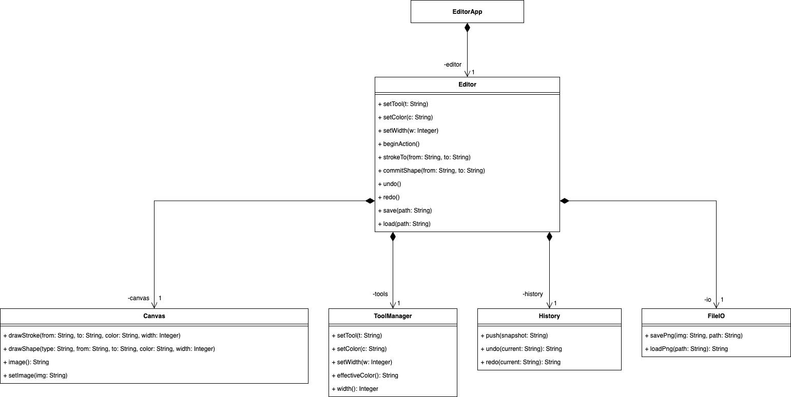

# Лабораторная работа №2 — Структурные паттерны

**Паттерн:** Фасад (Facade)
**Предметная область:** графический редактор

Код: [без паттерна](WithoutPattern/main_without_facade.cpp) · [с паттерном](WithPattern/main_with_facade.cpp)

---

## 1. Постановка проблемы

Приложение «ShapeEditor» — простой графический редактор. Поддерживает карандаш, линию, прямоугольник, овал, ластик, выбор цвета и толщины, undo/redo, сохранение и загрузку PNG.

Внутри редактора выделяются четыре независимые подсистемы:

- **`Canvas`** — холст и собственно отрисовка графических элементов.
- **`ToolManager`** — текущий инструмент, выбранный цвет, толщина линии.
- **`History`** — undo/redo, хранящие снимки холста.
- **`FileIO`** — сохранение и загрузка изображения в PNG.

**Постановка проблемы.** Если клиент (`EditorApp`) работает со всеми четырьмя подсистемами напрямую, возникает **сильная зависимость** между классом клиента и классами подсистем:

- Клиент вынужден сам держать у себя объекты `Canvas`, `ToolManager`, `History` и `FileIO`.
- Клиент сам координирует их взаимодействие — практически каждое действие пользователя требует сразу нескольких подсистем (например, рисование карандашом = снимок в `History` при нажатии мыши + чтение цвета и толщины из `ToolManager` + рисование на `Canvas`).
- Любое изменение в подсистемах заставит переписывать весь UI.
- Если нужно добавить нового клиента (например, консольную или веб-версию) — придётся дублировать всю координацию.

---

## 2. Решение

Паттерн **Фасад** предоставляет единый упрощённый интерфейс к набору интерфейсов подсистемы.

Вводим класс `Editor` (фасад), который владеет всеми четырьмя подсистемами и предоставляет клиенту простые команды: `beginAction()`, `strokeTo()`, `commitShape()`, `undo()`, `redo()`, `save()`, `load()` и т.д. Каждая команда сама вызывает нужные подсистемы в правильном порядке. Клиент `EditorApp` работает только с фасадом и о классах подсистемы не знает. Подсистемы о фасаде не знают и не связаны друг с другом.

---

## 3. Реализация без паттерна

Клиент `EditorApp` напрямую держит все четыре подсистемы ([строки 180–183](WithoutPattern/main_without_facade.cpp#L180-L183)) и сам их координирует.

Обработка мыши — в `eventFilter` ([строки 207–247](WithoutPattern/main_without_facade.cpp#L207-L247)):

```cpp
class EditorApp : public QMainWindow {
    Canvas      canvas_;
    ToolManager tools_;
    History     history_;
    FileIO      io_;
    // ...

    bool eventFilter(QObject* obj, QEvent* ev) override {
        // ...
        if (ev->type() == QEvent::MouseButtonPress) {
            // ...
            startPoint_ = me->pos();
            lastPoint_  = me->pos();
            history_.push(canvas_.image());          // клиент сам делает снимок в историю
            // ...
        }

        if (ev->type() == QEvent::MouseMove && drawing_) {
            // ...
            ShapeType t = tools_.tool();
            if (t == ShapeType::Pencil || t == ShapeType::Eraser) {
                // клиент сам берёт настройки из ToolManager и сам рисует на Canvas
                canvas_.drawStroke(lastPoint_, me->pos(),
                                   tools_.effectiveColor(), tools_.width());
                lastPoint_ = me->pos();
                // ...
            }
            // ...
        }
        // ...
    }
};
```

Открытие файла — обработчик кнопки «Открыть» ([строки 347–361](WithoutPattern/main_without_facade.cpp#L347-L361)), клиент сам знает порядок вызовов трёх подсистем:

```cpp
connect(openAct, &QAction::triggered, this, [this]() {
    QString path = QFileDialog::getOpenFileName(/* ... */);
    // ...
    QImage loaded = io_.loadPng(path);
    history_.push(canvas_.image());
    canvas_.setImage(loaded);
    // ...
});
```

### Минусы
- **Сильная зависимость** клиента сразу с четырьмя подсистемами: из `EditorApp` к ним 43 обращения.
- Координация размазана по UI: один обработчик события мыши знает про `Canvas`, `ToolManager` и `History` одновременно. Правило «снимок в историю перед изменением» повторено в клиенте 5 раз.
- При изменении интерфейса любой из подсистем переписывать придётся весь `EditorApp`.
- Появление новых клиентов приведёт к дублированию кода.
- Затруднённое тестирование.

---

## 4. Реализация с паттерном Фасад



Вводим класс `Editor` — **фасад**, который прячет все четыре подсистемы ([строки 165–223](WithPattern/main_with_facade.cpp#L165-L223)):

```cpp
class Editor {
    Canvas      canvas_;
    ToolManager tools_;
    History     history_;
    FileIO      io_;
public:
    Editor(int w, int h);

    void setTool(ShapeType t);
    void setColor(const QColor& c);
    void setWidth(int w);

    void beginAction();
    void strokeTo(const QPoint& from, const QPoint& to);
    void commitShape(const QPoint& from, const QPoint& to);

    void undo();
    void redo();

    void save(const QString& path);
    void load(const QString& path);
    void clearAll();

    // + геттеры: image(), width(), height(), currentTool(), currentColor(), canUndo(), canRedo()
};
```

Координация подсистем теперь внутри фасада, например ([строки 214–217](WithPattern/main_with_facade.cpp#L214-L217)):

```cpp
void Editor::load(const QString& path) {
    history_.push(canvas_.image());
    canvas_.setImage(io_.loadPng(path));
}
```

Теперь клиент работает **только с фасадом** ([поле — строка 258](WithPattern/main_with_facade.cpp#L258), [eventFilter — строки 282–321](WithPattern/main_with_facade.cpp#L282-L321)):

```cpp
class EditorApp : public QMainWindow {
    Editor editor_;
    // ...

    bool eventFilter(QObject* obj, QEvent* ev) override {
        // ...
        if (ev->type() == QEvent::MouseButtonPress) {
            // ...
            startPoint_ = me->pos();
            lastPoint_  = me->pos();
            editor_.beginAction();
            // ...
        }

        if (ev->type() == QEvent::MouseMove && drawing_) {
            // ...
            ShapeType t = editor_.currentTool();
            if (t == ShapeType::Pencil || t == ShapeType::Eraser) {
                editor_.strokeTo(lastPoint_, me->pos());
                lastPoint_ = me->pos();
                // ...
            }
            // ...
        }
        // ...
    }
};
```

Открытие файла ([строки 419–431](WithPattern/main_with_facade.cpp#L419-L431)):

```cpp
connect(openAct, &QAction::triggered, this, [this]() {
    QString path = QFileDialog::getOpenFileName(/* ... */);
    // ...
    editor_.load(path);
    // ...
});
```

### Плюсы
- **Слабая зависимость** клиента от подсистемы: `EditorApp` зависит только от `Editor`, обращений к `Canvas`, `ToolManager`, `History`, `FileIO` из клиента нет.
- Координация подсистем находится в одном месте — внутри фасада.
- Легко добавить новый UI — он будет использовать тот же фасад.
- При изменении `Canvas`, `ToolManager`, `History` или `FileIO` клиент трогать не нужно, правим только фасад.

---

## 5. Вывод

Внедрение паттерна Фасад не изменило поведение программы и классы подсистем — изменилось распределение ответственности. Знание о том, как подсистемы работают вместе (порядок вызовов, снимок в историю перед изменением, передача цвета и толщины на холст), перенесено из обработчиков GUI в один класс `Editor`.

В результате:
- клиент `EditorApp` знает один класс вместо четырёх, его обработчики стали короче и проще;
- зависимость от подсистемы не исчезла, а сосредоточилась в фасаде — изменения в подсистемах затрагивают только `Editor`;
- тот же фасад можно переиспользовать для другого клиента (консольного, тестов) без дублирования логики.
